# Journeymeter

**Production-ready JMeter load tests from your OpenAPI spec. In hours, not months.**

## Why

B2B teams need performance numbers they can trust before every release. Hand-building good JMeter tests takes weeks: chaining calls, wiring sign-in, feeding test data, getting the scenario mix right, and measuring only once the system is warm.

Journeymeter does that work for you. If you have a Swagger or OpenAPI file, you can have a high-quality test the same day.

## Features

- **Hours, not weeks.** Import the spec, confirm sensible defaults, run.
- **Realistic scenario mix.** User journeys built from your endpoints, weighted the way real users behave.
- **Steady-state measurement.** Ramp-up and warm-up are excluded. Results come from a fully loaded, warm system only.
- **Clean JMeter plans.** Parameterised, readable, reviewable. Nothing hard-coded.
- **Test data done right.** A data pack your data team fills in. Every row is validated and dealt so users never collide.
- **Real sign-in.** Entra ID, OpenID Connect, your API's own login, or ready-made tokens, with token refresh.
- **CI ready.** Export a bundle for GitHub Actions or Jenkins with pass or fail gates.
- **Private.** Runs in Docker on your machine or network. Nothing leaves it.
- **No JMeter skills needed.** Designers work with users, journeys and steps. Engineers can still open and extend the plan.

## Who it is for

- **QA leads and product owners** who need answers, not a JMeter course.
- **Performance engineers** who want a solid plan to start from.
- **Teams** who keep tests in git and run them in every pipeline.

## Status

In active development.

## License

[MIT](LICENSE)
